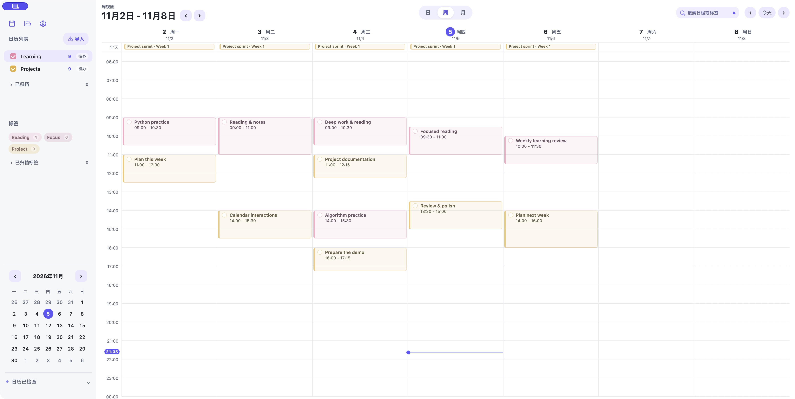
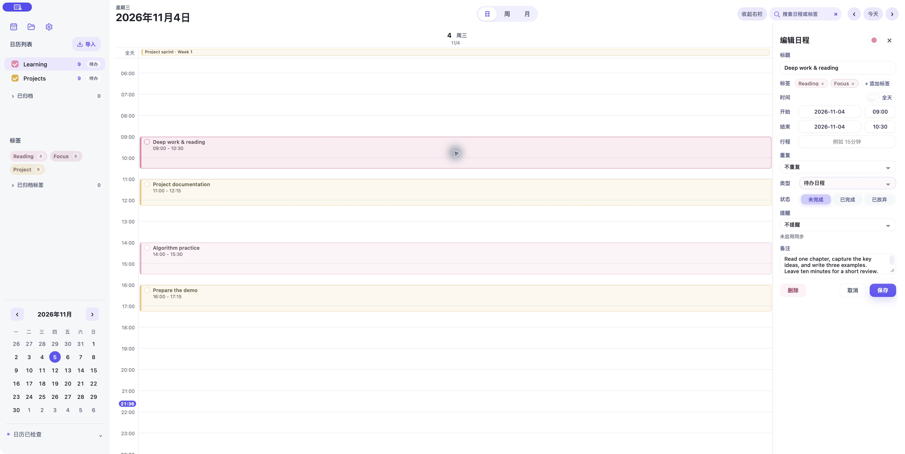
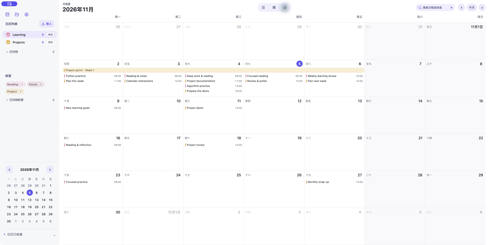

# Daily Planner

A local-first calendar and task planner for macOS and the web. Organize study, projects, and everyday life in day, week, and month views, with local JSON backups and optional Apple Calendar integration on Mac.

## Screenshots

The macOS app in its light theme, with pink **Learning** and yellow **Projects** calendars. These screenshots use sample data in an isolated native app window, maximized to the available desktop area without entering macOS full-screen mode. The app interface is currently in Chinese.

**Week view — see focused work and project plans together.**



**Day view — edit an event alongside the day's schedule.**



**Month view — browse the month and track multi-day plans.**



## Features

| Feature | What it does |
| --- | --- |
| Day, week, and month views | Timelines, a six-week month grid, lunar dates, and all-day or multi-day events |
| Events and tasks | Choose the type per item; mark tasks open, completed, or abandoned |
| Drag and resize | Drag empty space to create an event, move cards, or resize their start and end times |
| Calendars and tags | Color, reorder, merge, archive, and filter calendars; organize events with tags |
| Search | Search across dates by title, notes, date, time, calendar, or `#tag`, with keyboard navigation |
| Editing protection | Local drafts, validation, recurring-series edits, and operation-level undo |
| Local data | JSON files, automatic saving where supported, safety backups, and recovery |
| Apple Calendar | Limited two-way synchronization and calendar reminders in the Mac app |
| Appearance | Three themes, a resizable sidebar, compact search, and native Mac window controls |

Selected cards and creation previews follow their calendar's color. Resizing snaps to 15-minute increments, keeps the opposite edge fixed, and supports undo.

## Quick start

Requires **Node.js 22 or later**. Run from the repository root:

```bash
npm ci
npm run dev
```

Open [http://127.0.0.1:4173](http://127.0.0.1:4173). The development command builds the app before starting the static server. After changing source files, rebuild and refresh the page, or restart the command; automatic watching is not enabled.

Chrome and Edge can automatically write changes back to an opened JSON file through the File System Access API. Other browsers can use local storage, import files, and download backups manually.

### Build the Mac app

Requires macOS, Xcode Command Line Tools, and Python with Pillow:

```bash
npm ci
python3 -m venv .venv
.venv/bin/python -m pip install Pillow
PYTHON_BIN="$PWD/.venv/bin/python" bash macos/build-mac-app.sh
```

The script creates `dist/日程.app` and `dist/日程-mac.zip`. It uses ad hoc signing and does not install the app, apply a Developer ID signature, or perform Apple notarization.

## Everyday use

- **Create and edit:** drag on an empty day/week timeline, or click a card to open its editor. Drag a card to move it; use its top or bottom edge to resize it.
- **Manage calendars:** select a calendar as the default for new items. Right-click to rename, recolor, merge, change its type, archive, or delete it. Deleting a calendar also deletes its items after confirmation.
- **Find items:** search across all dates in visible, unarchived calendars. Click a tag to filter; click the same tag again to jump to the next matching event.
- **Keep drafts:** unfinished edits are stored separately on the current device. Closing or switching editors offers save, discard, or continue options.
- **Edit recurring items:** apply changes to one occurrence, that occurrence and later ones, or the whole series. Task completion changes only the current occurrence. A batch edit can be undone as one operation.
- **Undo safely:** undo affects only the records changed by that operation. Later edits, active drafts, or unresolved Apple conflicts can block an undo to protect newer data.
- **Maximize the Mac window:** double-click an empty draggable area in the top bar to fill the available desktop area; double-click again to restore its previous size. This is separate from macOS full-screen mode.

## Saving and recovery

The app stores its state locally in the browser or Mac WebView. The file menu can create, open, or save `daily-planner-data.json`. On Mac and in compatible browsers, changes can be written automatically to the connected file.

JSON exports include events, calendars, tags, view preferences, and Apple synchronization metadata. Editor drafts stay on the current device and are not included in the JSON file. Browser/PWA data is local to each device and site; use JSON files to move it between environments.

Safety backups are created before file replacement, imports, and incoming synchronization changes:

| Environment | Recovery |
| --- | --- |
| Mac app | Backups are stored in `~/Library/Application Support/DailyPlanner/Backups`. Open the backup folder from the recovery panel, then load a JSON backup through the file menu. |
| Browser/PWA | The latest ten local safety snapshots can be downloaded from the recovery panel and opened again. |

Restoring a backup also preserves the current version first. Personal planner files, backups, secrets, dependencies, and generated builds are excluded from Git.

## Apple Calendar integration

```text
Mac app ↔ Apple Calendar on this Mac ↔ Calendar account, such as iCloud ↔ iPhone / iPad
```

The Mac app uses EventKit to synchronize dedicated calendars it creates and tracks. Grant calendar access when prompted, and control synchronization from each calendar's menu. Checks run on startup, when the app gains focus, every 30 seconds, and after local saves. A manual check is available in Settings. The app must be open to reconcile changes.

- **Shared fields:** title, dates, start/end times, all-day status, notes, managed calendar, and supported reminders. Tags, task status, and travel time remain app metadata.
- **Conflict handling:** the app compares local data, Apple data, and the last confirmed baseline. Concurrent edits or deletion/edit conflicts retain both versions for review.
- **Drafts and deletions:** items with unsaved drafts are deferred. An Apple-side deletion moves an unchanged local item into recovery. Incoming changes and writes are protected by local saving and backups.
- **Discovery:** ordinary events added to a managed calendar can be imported. Initial discovery covers two years before and after the current date; already linked items are looked up individually.
- **Limits:** native Apple recurring series and exceptions, duplicate synchronization identifiers, and items moved to unrelated calendars require manual handling. App-created or imported series are synchronized as individual events.
- **Unavailable accounts:** a missing account or managed calendar pauses synchronization rather than being treated as a deletion of every event. Archiving or disabling synchronization leaves the Apple calendar in place.

A successful check confirms the state of **Apple Calendar on this Mac**. Delivery to an iPhone or iPad depends on the system calendar account.

### Reminders

Set relative reminders for timed events, or a local time on the same or previous day for all-day items. Apple Calendar sends the notifications; the app does not schedule a separate notification service, and the web version only stores the settings.

Existing multiple reminders and fixed-date reminders survive ordinary edits. Special location, email, or sound reminders are read-only in the app. Completing or abandoning a task clears that occurrence's reminders; reopening the task does not automatically restore them.

## ICS import

Import a local `.ics` file or a calendar URL, review the preview, and add it as a separate calendar. Parsing uses the bundled [ICAL.js library](vendor/README.md).

- Supports UTC, floating times, IANA time zones, and embedded `VTIMEZONE` definitions. Timed events are converted to the device's time zone.
- Supports common daily, weekly, monthly, and yearly recurrence patterns, intervals, counts, end dates, weekly weekdays, exclusions, ordinary additional dates, and individual moved or cancelled occurrences.
- Open-ended series expand for two years from their start date. Limits are 1,000 occurrences per series, 5,000 events per file, and 5 MB per file.
- Unsupported complex rules, unknown time zones, or invalid dates reject the import with an explanation. URL imports are one-time reads, not live subscriptions.

## Development

```bash
npm ci
npm run check       # Type checking, strict core checks, build, and all tests
npm run build       # Build web and offline assets
npm run benchmark   # Synthetic search benchmark
git diff --check
```

Native checks run on macOS without writing to real calendars:

```bash
python3 tests/native/check-apple-dates.py
python3 tests/native/check-apple-reminders.py
python3 tests/native/check-apple-duplicates.py
python3 tests/native/check-apple-queue.py
python3 tests/native/check-window.py
```

Tests, screenshots, and packaging checks cover different scopes. Real iCloud propagation, device notifications, and distribution acceptance require separate verification. See the [changelog](CHANGELOG.md) and [historical acceptance records](docs/testing/APPLE_SYNC_ACCEPTANCE.md).

### Project structure

```text
src/
├── app.ts / app/      # Bootstrap, shared state, events, and persistence
├── types/            # Shared business and interaction types
├── domain/           # Pure date, state, and layout calculations
├── ui/               # Calendar views, editor, menus, themes, and styles
├── editor/           # Drafts, recurring-series logic, and undo
├── search/           # Search index and date filtering
├── storage/          # Local storage and backups
├── import/           # ICS parsing
├── sync/             # Apple Calendar reconciliation
└── platform/         # File APIs, native bridge, and window controls
macos/                # Swift / AppKit / WKWebView shell and EventKit
config/web-assets.txt # Shared web and Mac distribution manifest
scripts/              # Build and local server
tests/                # Core, DOM, native, and packaging checks
docs/                 # Architecture, verification records, and screenshots
```

Application code uses TypeScript ES modules. Shared business types belong in `src/types/`, and core calculations in `domain/` do not depend on UI code. Edit source files instead of generated `build/` files or `sw.js`. New runtime web assets must be added to both `config/web-assets.txt` and `src/service-worker.ts`. See the [architecture guide](docs/ARCHITECTURE.md) for more detail.

## Static hosting and privacy

Build with `npm ci` and `npm run build`, then publish the files listed in `config/web-assets.txt`, preserving their paths. The entry point is `index.html`. HTTPS hosting enables installation as a PWA on mobile devices. No application backend is required.

Planner data stays local by default. Enabling Apple synchronization sends the shared fields to the selected system calendar account. Remote ICS import includes a third-party proxy fallback, and the icon script loads from a third-party CDN. Only use calendar URLs that may be sent to those services. Distribution assets do not include personal planner files.
