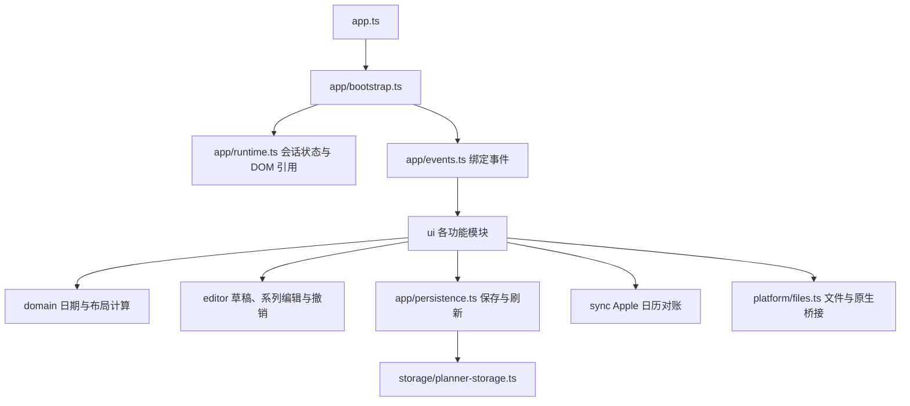

# 架构与开发指南

## 从哪里开始读

`src/app.ts` 是浏览器入口，只加载 `app/bootstrap.ts`。启动模块注册原生回调，恢复本地数据和草稿，绑定事件，首次渲染，然后启动文件连接与同步。



| 目录/文件 | 责任 |
| --- | --- |
| `types/model.ts` | 持久化日程、来源、标签、提醒、编辑草稿、同步快照与冲突 |
| `types/interaction.ts` | 拖拽、框选、粘贴等临时状态，不写入数据文件 |
| `types/platform.d.ts` | WebKit 文件与 Apple 同步桥、图标接口 |
| `app/config.ts`、`app/default-state.ts` | 配置常量与初始文档，初始化逻辑集中维护 |
| `app/runtime.ts` | 显式的共享会话容器，持久化文档位于 `runtime.state` |
| `app/queries.ts` | 依赖当前文档的查询；纯日期计算在 `domain/` |
| `ui/render.ts`、`ui/calendar.ts`、`ui/event-cards.ts` | 总体渲染、时间轴与日程卡片 |
| `ui/event-drag.ts`、`ui/event-create.ts` | 移动、缩放、框选与拖拽新建 |
| `ui/editor.ts`、`ui/event-save.ts`、`ui/drafts.ts` | 编辑表单、提交校验与草稿保护 |
| `ui/apple-sync.ts` | 连接 UI、存储、原生传输与 Apple 同步核心 |
| `sync/apple-sync.ts` | Apple 三方对账、写入确认与冲突合并 |
| `editor/`、`search/`、`storage/`、`import/` | 可独立测试的业务模块 |
| `ui/styles.css` | 样式入口；按原有层叠顺序导入 `ui/styles/` |
| `platform/files.ts` | 浏览器文件 API、IndexedDB 句柄、下载、自动保存和 WebKit 请求 |

UI 模块使用显式 ES import/export，功能之间共享同一会话容器。网页/PWA 使用本地存储与 JSON 文件；Mac 原生版通过 EventKit 对接 Apple 日历。

## 构建与验证

```bash
npm ci
npm run check       # 整体类型检查 + 核心 strict + 构建 + 所有回归
npm run dev         # 构建后预览，http://127.0.0.1:4173
npm run build       # 仅构建发行资源
npm run benchmark   # 搜索合成基准
npm run format      # 统一源码、样式与测试排版
bash macos/build-mac-app.sh
```

本地预览目前不自动监听源码；修改后重新构建并刷新页面。网页源码统一使用 `.ts`，ES 模块中的 `.js` 导入路径由 TypeScript/esbuild 解析到相应源码。

`tsconfig.json` 检查所有应用、构建脚本和配置。`tsconfig.core.json` 对日期、数据、搜索、存储、编辑、撤销及同步核心启用 `strict: true`。UI 事件处理及第三方 ICS 适配暂用宽松检查，部分参数仍为隐式类型；没有用 `@ts-nocheck` 或批量 `any` 绕过检查。测试由 tsx 执行，并未声称整个测试集通过 strict 检查。

`npm test` 先重新构建，再执行 TypeScript 测试。DOM 回归使用独立的 `build/test-browser.js`，只在测试页面暴露内部函数；生产包只保留 Swift 需要的两个原生回调。原有同步竞态测试继续在隔离 VM 中运行真实协调函数，生产页面另有启动验证。

## 发行资源

`build/app.js`、`build/app.css` 和根目录 `sw.js` 均由源码生成，不提交。每次构建根据页面与编译内容生成缓存版本，防止缓存沿用旧脚本。`config/web-assets.txt` 是 Mac 打包和静态发布的文件清单。

新增网页资源时同时更新资源清单与 `src/service-worker.ts` 的离线缓存列表，并执行打包资源测试。第三方 `vendor/ical.cjs` 原样保留，扩展名只用于声明 CommonJS；许可和原始代码仍随发行包提供。

## 改动边界

- 个人日程 JSON、备份和浏览器存储键不变。
- Swift 原生代码和 Python 日历检查保留各自语言；第三方源码不强行转写。
- 旧数据中的未知顶层字段继续保留，但已移除的云同步元数据不参与保存调度、合并或撤销保护。
- 自动测试和构建不等于真实 iCloud/iPhone 同步或人工界面验收。
